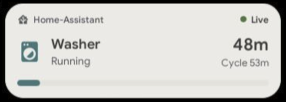
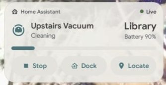

# Live Activities

 

A [Kiosk Satellite](https://github.com/jxlarrea/kiosk-satellite) plugin that shows Home Assistant activities as native cards over the screensaver, Immich photos included. Use it for a dishwasher or washer cycle, a robot vacuum, a thermostat, EV charging, solar production, someone's travel time or any other entity.

Home Assistant owns the state and every calculation. The plugin shows the entities and attributes you pick. It does not detect appliances, predict arrival times or run automations.

> [!NOTE]
> This plugin was created with assistance from AI (Claude Code). Every change is tested and reviewed. See [Tested devices](#tested-devices) for the hardware it has run on.

## Installation

### Community Plugins (Recommended)

Live Activities is listed in [Community Plugins](https://kiosksatellite.com/plugins/). Use the button below to open it in your Kiosk Satellite and install it.

[](https://kiosksatellite.com/redirect/plugin/?repository=jtscott/ks-live-activities)

Or search for `Live Activities` in **Settings > Plugin Manager > Browse plugins** in Kiosk Satellite.

### Manual

1. Open **Settings > Plugin Manager** in Kiosk Satellite and turn on **Enable Plugins**.
2. Choose **Add plugin**, paste `https://github.com/jtscott/ks-live-activities` and choose **Preview**.
3. Review the plugin and choose **Trust and install**.

Then enable it, open its settings and add an activity under **Activities**. [Examples](#examples) has complete setups for a washer, a vacuum, a thermostat and more.

## Requirements

**Kiosk Satellite 2026.10.30 or later.** The plugin uses:

| Feature | Since |
| --- | --- |
| Entity state subscriptions (`host.read`, `ha.entity.*`) | 2026.9.42 |
| Native overlays with insets and offsets, `KsTheme.icon`, list settings, `visibleWhen` and `required` | 2026.10.23 |
| Home Assistant calls (`ha`), for controls and the unit system | 2026.10.25 |
| Settings page buttons (Show preview, Hide preview), overlays that follow **Scale UI** | 2026.10.30 |

The manifest says so in `minAppVersion`, so Kiosk Satellite 2026.10.40 and later refuse to install or update the plugin on an older release and name both versions; 2026.10.39 and older ignore the field. X, Y, Empty at and Full at are typed number fields from 2026.10.35 and sliders before. Material Design Icons with a number in their name, such as `mdi:battery-80`, draw from 2026.10.35. Kiosk Satellite must have its Home Assistant URL and token set.

## Tested devices

| Model | Codename | Android | Supported firmware fingerprint | Kernel | Status |
| --- | --- | --- | --- | --- | --- |
| Meta Portal 10-inch (2nd generation) | omni | 10 | `Facebook/omni_prod/omni:10/QKQ1.210213.001/3051355900018050:user/prod-keys` | 4.9.227-perf+ | Tested |

Running it on something else? Open an issue or a pull request with your device's row. With ADB connected, this prints the codename, Android version, firmware fingerprint and kernel:

```sh
adb shell 'getprop ro.product.device; getprop ro.build.version.release; getprop ro.build.fingerprint; uname -r'
```

## How it works

- **It follows only what the cards read, and only while they can show.** When the screensaver or the preview starts, the plugin subscribes to the entities its activities use through Kiosk Satellite's own Home Assistant connection. Kiosk Satellite sends each one's state at once and then every change, attribute changes included. When both end, the plugin lets go of all of them. An idle kiosk follows nothing.
- **Changing settings touches Home Assistant only when the entities change.** A new title, icon, layout, heading, color, position or size redraws the cards. The one exception is the Integration heading, which reads each card entity's integration once and keeps it. Adding or removing an entity subscribes or unsubscribes just that one. Each change restarts Kiosk Satellite's shared entity connection, so the plugin makes them in one batch.
- **16 entities in all.** Kiosk Satellite follows at most 16 entities for one plugin. Activities count in list order, and one that would pass 16 is left out whole and named in the plugin's status.
- **One overlay, updated in place.** The cards are one native overlay drawn with `onTop(true)`, so they sit over the screensaver. Kiosk Satellite builds an overlay's view slowly on low-power panels, so the cards change inside it instead of replacing it. While a finger is on the cards, updates wait and are drawn when it lifts, so a value changing mid-tap never cancels the tap. Back leaves the overlay alone.
- **Taps.** The cards take taps, for their buttons and the `+N more` button, so a tap on a card does not wake the kiosk. Tap anywhere else to wake it. Unlike Screensaver Agenda's card, this overlay always takes touches: a short screen can leave out cards at any time, and `+N more` must then work.

### What a card shows

- **Top left:** the Home Assistant icon and the **Heading**: `Home Assistant` by default, or the integration, the entity's name or your own text.
- **Top right:** the connection, from what Kiosk Satellite reports for the card's entities:
  - **Live**: Home Assistant is connected and reporting. A paused appliance is still Live, and a sensor that has not changed in hours is still Live.
  - **Connecting**: the first state has not arrived yet.
  - **Reconnecting**: the connection dropped after the card showed data. The card keeps its last values, dimmed, and turns its buttons off. Kiosk Satellite reconnects on its own.
  - **Unavailable**: Kiosk Satellite has no Home Assistant set up, or never reached it.
- **Main:** the icon, title and status on the left, a primary value and an optional labelled secondary value, such as `Battery 80%`, on the right.
- **Middle:** a progress bar, or large current and target values with what the device is doing between them.
- **Bottom:** the card's buttons. The row is left out when there are none.
- **Notes:** "Sending Pause…", "Pause sent", "Pause failed: …" under the buttons.

Values are Home Assistant's own. `unknown`, `unavailable`, a missing entity (`Not found`), a missing attribute (`—`) and a non-numeric progress value each show as such: never as 0, done or off, and an unknown progress shows no bar. A finish time in the future counts down (`1h 4m`, rounded up to the minute). One in the past shows as a time, never as "done". A duration sensor shows as `1h 4m`. Numbers use the kiosk's language for the decimal separator.

Cards keep the order of the list and never rearrange themselves by value. **Maximum cards** sets how many show; a `+N more` button counts the rest, along with any the screen is too short for. A card that does not fit whole is left out rather than cut off; when not even one fits, `+N more` is all that shows. Tap it to open every card in a list that scrolls within the screen, with their values and buttons, and tap **Show fewer** at its end to close it. The list closes by itself when the screensaver and preview end.

## Setting up an activity

| Field | Notes |
| --- | --- |
| Type | **Appliance**, **Vacuum**, **Climate** or **Custom**. A starting point, see below |
| Entity | The main entity. Its state is the status unless **Values** sets one |
| Enabled | Off keeps the activity but shows and follows nothing for it |
| Title, Icon | Empty uses the entity's name and icon, then the type's icon |
| Layout | **Automatic**, **Status**, **Progress** or **Current/target**. Automatic picks Current/target for Climate, Progress when a Progress value is set, otherwise Status |
| Values | Up to 6 rows. Each shows one entity's state or one of its attributes as the **Primary value**, **Secondary value** (with a **Label**), **Progress** (with **Empty at** and **Full at**), **Status**, **Current** or **Target**. An empty entity reads the activity's own. **Unit** names the unit of an attribute; a state brings its own |
| Show | **Always**, **When state is** or **When state is not**, with a **Condition entity** (empty: the activity's entity) and its **States**, comma separated, as Developer Tools > States shows them. `unknown` and `unavailable` show a card only when listed under When state is; When state is not always hides them, so `When state is not: off` hides a card whose entity drops out. A card whose condition entity has not reported yet stays hidden |
| Controls | Vacuum: a list of the buttons to show, in your order. Climate: a switch for Cooler and Warmer. See [Controls](#controls) |
| Action, Action label | Appliance and Custom. A `script`, `button` or `input_button` the card can run |

The types:

- **Appliance:** a progress layout once you add a Progress value. Pair it with its status sensor and add time left, progress and anything else under Values.
- **Vacuum:** the vacuum's state as its status (Cleaning, Paused, Docked, Returning). Home Assistant no longer puts the battery on the vacuum, so add its battery sensor as a Secondary value labelled Battery.
- **Climate:** current temperature and target from the thermostat's attributes, the HVAC mode under the title (`Heat mode`) and its action (`Heating`, `Idle`) between the values. A heat/cool range shows as `20.0° – 24.0°`.
- **Custom:** any entity, with whatever Values you give it.

### Controls

Each press sends one Home Assistant call. Nothing is sent again on its own, also after a timeout, since the first call may still have worked. While a call is out, that card's buttons are off and it says "Sending…". Buttons are off while the card is not Live.

- **Vacuum:** add the buttons you want under **Controls**; they show in that order, each only when the vacuum supports it and it applies right now:
  - **Pause** while cleaning, and **Resume** in its place while paused (Resume needs the vacuum to support starting).
  - **Dock** while cleaning, paused, idle or in error.
  - **Locate** in any state Home Assistant can reach it, docked included.
  - **Start** from the dock or idle.
  - **Stop** while cleaning, paused or returning.

  With no Controls rows, or none the vacuum supports, the card has no buttons.
- **Climate:** **Cooler** and **Warmer** move the target one step, within `min_temp` and `max_temp`, if the thermostat supports a target temperature and is not off. The step is the thermostat's `target_temp_step`, or Home Assistant's default for its unit system: 0.5 °C or 1 °F, read once with `get_config`. A second step builds on the target still on its way. Ranges are not adjustable in this version.
- **Appliance and Custom:** one button that runs the **Action**: `script.turn_on`, which returns at once, or `button.press`. Not every appliance can pause or stop from Home Assistant; offer what yours can through a script or button.

## Examples

Entity names below are examples: use your own.

**Washer (LG ThinQ), as in the screenshot.** Type Appliance, Entity `sensor.washer_current_status`, Title Washer, Show When state is not `power_off, initial, display_loadsize, end`. LG washers can stay at `end` for hours with the times cleared, so the card leaves when the cycle ends rather than when the washer powers off. Values:

| Show as | Entity | Label |
| --- | --- | --- |
| Primary value | `sensor.washer_remaining_time` | |
| Secondary value | `sensor.washer_total_time` | Cycle |
| Progress | `sensor.washer_progress` | |

LG ThinQ gives a finish time and a program length but no progress for this washer, and the plugin computes nothing itself, so the bar comes from a Template sensor helper in Home Assistant (Settings > Devices & services > Helpers > Create helper > Template > Sensor), with unit `%`:

- State: `{{ ([0, [100, 100 * (1 - (finish - now()).total_seconds() / 60 / total)] | min] | max) | round(0) }}{{ none }}`
- Availability (under Advanced options): `{{ has_value('sensor.washer_remaining_time') and states('sensor.washer_total_time') | float(0) > 0 }}`

While the washer is off it is unavailable, so the card shows no bar rather than 0%.

**Dishwasher (Home Connect).** Type Appliance, Entity `sensor.dishwasher_operation_state`, Title Dishwasher, Show When state is `run, pause`. Values:

| Show as | Entity | Label |
| --- | --- | --- |
| Progress | `sensor.dishwasher_program_progress` | |
| Primary value | `sensor.dishwasher_remaining_program_time` | |
| Status | `select.dishwasher_active_program` | |
| Secondary value | `binary_sensor.dishwasher_door` | Door |

Optional Action `script.dishwasher_pause` with Action label Pause.

**Robot vacuum.** Type Vacuum, Entity `vacuum.roborock_s7`, Controls Pause, Dock and Locate, Show When state is not `docked`. Values: Progress `sensor.roborock_s7_cleaning_progress`; Secondary value `sensor.roborock_s7_battery`, label Battery.

**Thermostat.** Type Climate, Entity `climate.hallway`, Controls on, Show Always or When state is not `off`.

**EV charging.** Type Custom, Entity `sensor.ev_charging_power`, Title Car, Show When state is `on` with Condition entity `binary_sensor.ev_charging`. Values: Progress `sensor.ev_battery_level`; Secondary value `sensor.ev_time_to_full`, label Full in.

**Solar production.** Type Custom, Entity `sensor.solar_power`, Layout Status, Show When state is `above_horizon` with Condition entity `sun.sun`. Values: Secondary value `sensor.solar_energy_today`, label Today. States compare as text, so a condition on the power sensor itself would need both `0` and `0.0`.

**Travel time.** Type Custom, Entity `person.alex`, Title Alex, Show When state is not `home`. Values: Primary value `sensor.alex_to_home_travel_time` (a Waze or Google travel time sensor); Secondary value `sensor.alex_to_home_travel_time`, attribute `distance`, label Distance, unit km.

## Card and progress bar settings

| Setting | Default | Notes |
| --- | --- | --- |
| Heading | Home Assistant | **Home Assistant**, **Integration**, **Entity name** or **Custom**. Integration names the integration behind each card's entity, such as `LG ThinQ`: the card says Home Assistant until Home Assistant has named it, and keeps saying so if it cannot (an entity without a registry entry, say). Entity name is the card entity's name in Home Assistant, such as `Washer Current status` |
| Heading text | (empty) | Shown for Custom, on every card. Empty shows only the icon |
| Buttons | Icon and label | Or **Icon only**, for every card's buttons. Each icon-only button keeps its name for screen readers |
| Colors | Theme | **Theme** follows Kiosk Satellite's light and dark themes. **Custom** uses the six colors below in both, starting from the light theme's own |
| Background, Outline | `#EFEDE9`, `#E3E0DA` | Shown for Custom. The card and the `+N more` button, and the hairline around a card |
| Text, Secondary text | `#444444`, `#5D6066` | Shown for Custom. Titles and values; the heading, status, labels, secondary value and notes |
| Accent | `#488284` | Shown for Custom. Activity icons, button text and icons, and the bar while Progress bar is Theme |
| Controls | `#E8E6E1` | Shown for Custom. Buttons, the current/target chip and the bar's track |
| Background opacity | 100% | 20 to 100%, in both color modes. Lower lets the screensaver show through |
| Progress bar | Theme | **Theme** uses the accent. **Solid** uses Bar color. **Gradient** runs from Bar color to Gradient end across the whole bar, so the color at the tip shows how far along it is |
| Bar color, Gradient end | `#488284`, `#749C6F` | Kiosk Satellite's teal and sage green |

The Live, Reconnecting and Unavailable colors, and the color of error notes, always follow the theme: they carry meaning, so a custom palette cannot make an unavailable card look live.

## Layout settings

| Setting | Default | Notes |
| --- | --- | --- |
| Maximum cards | 3 | 1 to 6 |
| Position | Top left | Screensaver Agenda's nine places or **Custom**. Top positions grow down, bottom ones grow up, middle ones stay centered on the stack. Left, center and right line the stack up |
| X, Y | 24, 24 dp | Shown for Custom: the stack's top-left corner from the top left of the kiosk area, with no inset. Kiosk Satellite keeps the stack on screen |
| Size | 100% | 60 to 200%. Presets keep 24 dp from the edges at 100%, scaled with Size. Buttons keep a 44 dp touch target |

Positions match [Screensaver Agenda](https://github.com/jtscott/ks-screensaver-agenda), so the two can share a screen. Both follow **Settings > Device > Scale UI**. Changing X or Y while a preset is chosen redraws nothing.

**Show preview** and **Hide preview** are buttons at the end of the Layout settings, and plugin actions for gestures and the drawer. The preview shows every enabled activity, also one whose Show condition is not met, with a note saying so, for placing the cards. **Its buttons are live: Pause, Dock, Warmer or an action pressed in the preview controls the real device.** The preview is not a setting, so it never syncs to other kiosks and ends with the session.

## Fleet behavior

The plugin's settings travel with Kiosk Satellite's own plugin and settings sync. Each kiosk then reads Home Assistant on its own and draws its own cards. There is no kiosk-to-kiosk traffic, leader or shared state. An activity's identity is its type and entity (numbered if repeated), so every kiosk derives the same one from the same settings without writing anything back. Visibility follows Home Assistant only: there is no dismissing, acknowledging or history on a kiosk.

## Data and privacy

The plugin talks only to your Home Assistant, through Kiosk Satellite's existing connection and account. It subscribes to the entities its activities read while the cards can show. It calls `get_config` once per showing for a thermostat without its own step, and a service only when someone presses a card's button. With the Integration heading it reads the card entities' registry entries (`config/entity_registry/get_entries`) and each of their integrations' manifests (`manifest/get`) once, one call at a time, for their names. It makes no network connections of its own, stores nothing outside Kiosk Satellite's plugin settings and logs no entity data.

## Known limitations

- Attributes are typed by name. There is no attribute picker yet.
- States show as Home Assistant reports them, with underscores as spaces and a capital first letter (`run` shows as `Run`), not translated.
- Climate shows `°` without the unit and does not adjust heat/cool ranges, humidity, fan or preset modes.
- Progress ranges are whole numbers from 0 to 10000.
- Custom X and Y place the stack's top-left corner, but Kiosk Satellite moves a stack that would run off screen.
- A finish time in the past shows as a time of day or a date, not as an elapsed time.
- The expanded list starts closed again whenever Kiosk Satellite rebuilds the view, such as after a theme or Scale UI change.
- A tap on a card outside its buttons does nothing; it does not wake the kiosk.
- Text is English.

## Credits

- [Kiosk Satellite](https://github.com/jxlarrea/kiosk-satellite) by Javier Larrea, whose [plugin SDK and tools](https://github.com/jxlarrea/kiosk-satellite-plugins) (Apache-2.0) are in `sdk/` and `tools/`, taken from that repository on 2026-10-26. `tools/community_plugins.py` adds one change: it checks each DEX file's declared size and reads at most the 4 MB limit, so a small compressed JAR cannot expand in memory before it is refused.

## Development

Needs JDK 17+, Python 3 and an Android SDK with platform 35 and build-tools.

```sh
export JAVA_HOME=/opt/homebrew/opt/openjdk@17/libexec/openjdk.jdk/Contents/Home
export ANDROID_HOME=$HOME/Library/Android/sdk
python3 tools/test.py
python3 tools/build.py --android-platform 35
```

For testing a local build, install `dist/live-activities-<version>.zip` with **Plugin Manager > Developer Tools > Install from ZIP**, on the kiosk or in the remote admin. Then enable it.

Releases are built by GitHub Actions: publishing a GitHub release tagged `vX.Y.Z` runs `.github/workflows/build.yml`, which tests, builds and attaches the manifest, ZIP and checksum. The tag sets the version.

`tools/test.py` runs `LiveActivitiesTest` once in UTC and once in America/Denver, then checks the manifest against Kiosk Satellite's rules (`tests/check_manifest.py`) and runs the SDK's own tool tests. `tools/check-sdk.py /path/to/kiosk-satellite` checks that `sdk/` matches the app.

The icon is drawn in `docs/icon.svg`; after changing it, render `assets/icon.png` with `sips -s format png docs/icon.svg --out assets/icon.png` on macOS.

Source: `Settings` parses the settings, `Cards` turns them and Home Assistant's states into card models (no Android, so the tests cover it), `ActivityOverlay` draws them, and `LiveActivitiesPlugin` runs the lifecycle.
